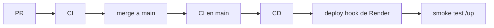

# Despliegue en Render

El MVP de demo corre como un **Web Service Free** en Render con runtime
**Docker** y rama **`main`**. El Auto-Deploy de Render debe quedar en
**Off**: el despliegue lo dispara el workflow **CD** de GitHub Actions
mediante el deploy hook, no el push a `main`. Render termina TLS en su
proxy; el contenedor escucha HTTP en un puerto sin privilegios (`PORT`,
por defecto `10000`).

La imagen compila el frontend con Node 24 y sirve Laravel con FrankenPHP.
Al arrancar, el entrypoint crea o actualiza una **SQLite efímera**, corre
migraciones, siembra el catálogo y los fixtures de demo, crea el enlace de
`storage` y cachea la configuración. Los datos del disco del contenedor se
pierden al recrearlo o al dormirse el plan Free: en el siguiente arranque
se vuelve a sembrar. Para persistencia real hay que cambiar SQLite por una
base gestionada.

El plan Free duerme el servicio. El primer request tras el idle provoca un
**cold start de alrededor de un minuto** (build de contenedor ya hecho;
el costo está en migrar, sembrar e `optimize`).

## Flujo CI → CD

```text
PR → CI → merge a main → CI en main → CD (deploy hook de Render) → smoke test /up
```



1. Un PR dispara **CI** (Calidad, Pruebas, Seguridad, Docker).
2. Tras el merge a `main`, CI vuelve a correr sobre esa rama.
3. Si CI en `main` termina en verde, **CD** hace POST al deploy hook de
   Render (`RENDER_DEPLOY_HOOK_URL`) y espera a que
   `https://rent-go-co67.onrender.com/up` responda 200. Espera 60 s el
   arranque en frío y reintenta hasta 10 minutos.
4. `workflow_dispatch` en CD sirve para un redeploy manual.

La URL pública es `https://rent-go-co67.onrender.com`. El secret
`RENDER_DEPLOY_HOOK_URL` vive solo en GitHub Actions; si falta, CD falla
con un mensaje claro y no despliega.

## Crear el servicio

1. En Render, **New > Web Service** conectado al repositorio.
2. Runtime **Docker**. Render usa el `Dockerfile` de la raíz.
3. Rama **`main`**. Auto-Deploy en **Off**.
4. Health Check Path: `/up`.
5. Render inyecta `PORT=10000`. El `Caddyfile` usa `{$PORT}`; no hace falta
   comando de inicio: el `ENTRYPOINT` es `entrypoint`.
6. Copia la URL del **Deploy Hook** al secret de GitHub
   `RENDER_DEPLOY_HOOK_URL`.

El job **Docker** de CI construye la imagen sin publicarla. El publish lo
hace Render cuando CD dispara el hook.

## Variables de entorno

Configura como mínimo:

```text
APP_NAME=Renta de vehículos
APP_ENV=production
APP_KEY=base64:...         # Generada fuera del repositorio
APP_DEBUG=false
APP_URL=https://rent-go-co67.onrender.com
DB_CONNECTION=sqlite
DB_DATABASE=/app/database/database.sqlite
SESSION_DRIVER=database
CACHE_STORE=database
QUEUE_CONNECTION=database
SESSION_SECURE_COOKIE=true
LOG_CHANNEL=stderr
MAIL_MAILER=log
```

`MAIL_MAILER=log` deja el correo de cambio de estado (RF-012) en el log del
servicio; el plan Free no envía SMTP. El envío es síncrono (sin colas).

`APP_KEY` es obligatoria. El script de arranque falla si falta; no se
genera una clave nueva en cada reinicio.

Laravel confía en los proxies (`trustProxies(at: '*')`) y, en producción,
fuerza el esquema `https` en las URLs. Hace falta porque Render termina
TLS delante del contenedor.

## Build y arranque manual

Para reproducir la imagen localmente:

```sh
docker build -t renta-vehiculos .
docker run --rm -p 8000:10000 \
  -e APP_KEY="$(php artisan key:generate --show)" \
  -e APP_ENV=production \
  -e APP_DEBUG=false \
  -e APP_URL=http://localhost:8000 \
  -e DB_CONNECTION=sqlite \
  -e DB_DATABASE=/app/database/database.sqlite \
  -e SESSION_DRIVER=database \
  -e CACHE_STORE=database \
  -e QUEUE_CONNECTION=database \
  renta-vehiculos
```

El contenedor corre como `www-data`. El binario de FrankenPHP no lleva
file capabilities (`setcap -r`): Render rechaza ejecutar binarios con
`CAP_NET_BIND_SERVICE`. Por eso se escucha en `10000` y no en `80`.

El entrypoint, en orden:

1. `php artisan migrate --force`
2. `php artisan db:seed --force` (idempotente con `updateOrCreate`; el
   catálogo mínimo corre una sola vez por arranque)
3. `php artisan storage:link --force`
4. `php artisan optimize`
5. `frankenphp run` con el `Caddyfile`

No se deben incluir secretos en el repositorio ni en el `Dockerfile`; se
configuran en **Environment** de Render.

## Health check

Laravel expone `/up`. En el plan Free, un 502 en el primer request suele
ser el cold start: espera ~1 min y reintenta. CD hace esa espera y
reintenta hasta 10 minutos. Si `/up` no responde 200, el job de CD falla
y el servicio se marca no saludable.
