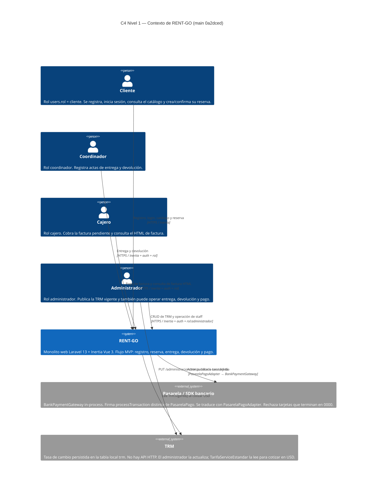
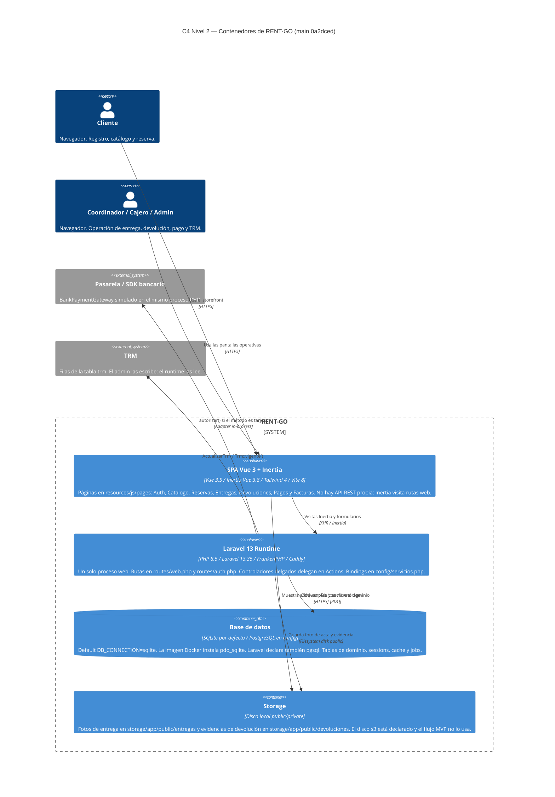
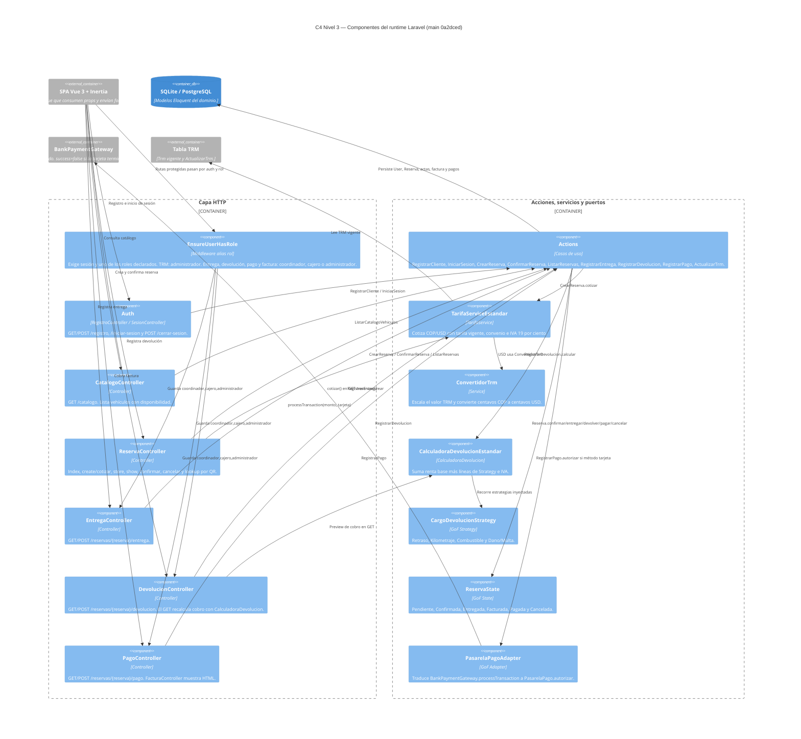
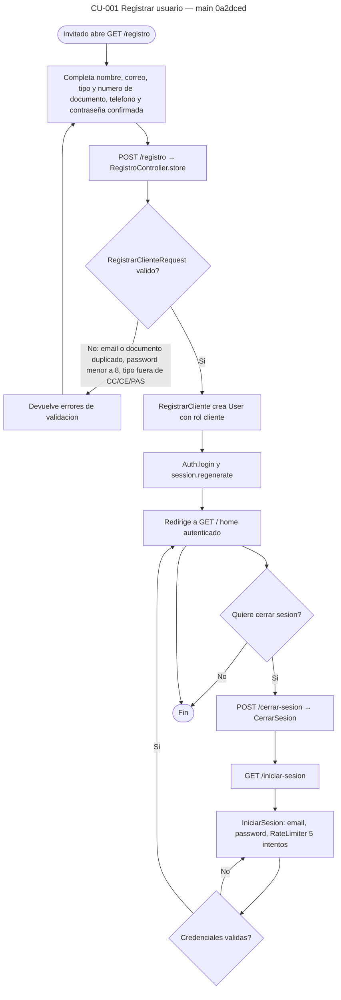
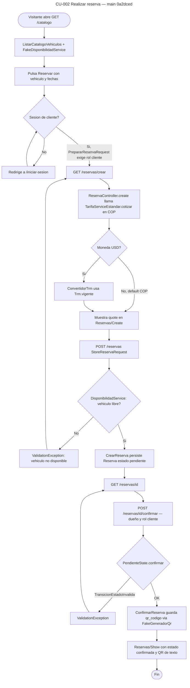
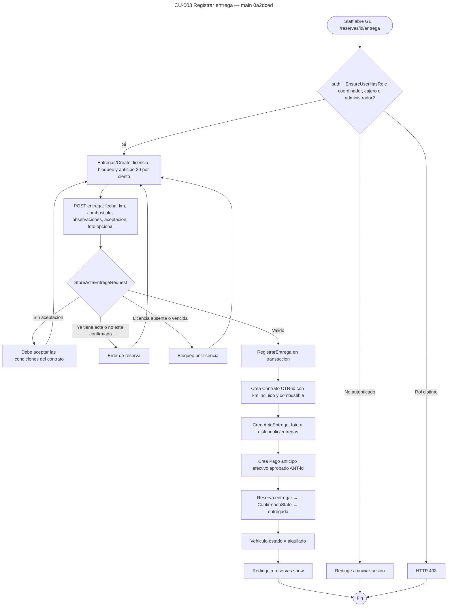
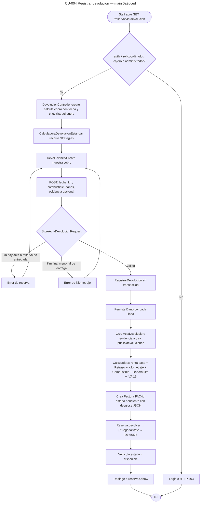
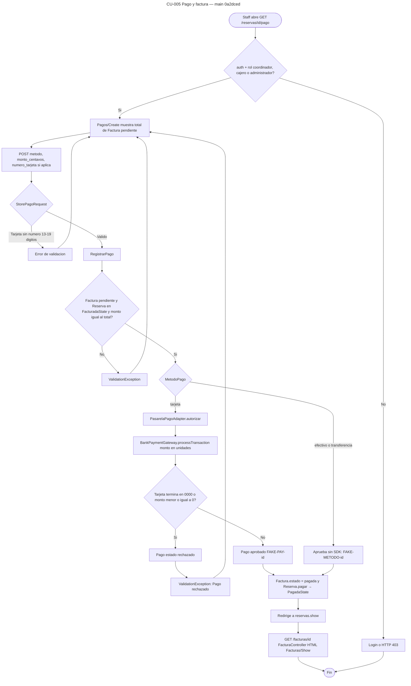

# Enlaces de diagramas — Entrega 2

Borrador generado desde `main` SHA `0a2dced533ee0d344565f82ca844696579f46f75`.
Cada enlace abre el editor de [mermaid.live](https://mermaid.live) con el código del archivo `.mmd`.

## Índice

- [C4 Nivel 1 — Contexto](https://mermaid.live/edit#pako:eNqVVctu20YU_ZUDrmRYodQmKxVZuLLyQC1XkOisCBRXwytp3OEMe2eoRA4CdNUPKPIDXXbRVT_Bf5IvKYakIjox0HY3Qw7Pg_cc8n2iXMHJJJk-mzob-F3IbdDBMKbPcK33bPANPv36Ed1dh4KxnF1nT17-iEFJ2mJM3xaKi7Pc5nbB4p0dKKPZBh4iT6btMk_iZukMas_iU3EGz9GdS7FiCG-1D0JDaKuVJnj2-v5vO4Ry1tcmENhAUbj_w7itwwFKmEbK2Y2WkuBrCHuWPaV5cnaS4pwU2lLhpJFz2p4k9c6kWHY6QCqQj3bZBuEt4YCC987UKsp6SEK3LK7Bb1Y96GafYurWQjCEDalQC6FiWzTmo5GewVfZ_CqSduce0FBRahuRL-KiUfnAB_Uvp1jUa6NVw5ot59jrbccXqFzr-z8tqpoLhqtYSI42h32XOKCirWtV5HZ18IHLgbAN28Zul4RWwtxZZ3RweMtrXJFQk56nOMdryxI04U3NeJrihalvHeZvFpPj1N3wOLzhf9fx0-xdGFTkSdhQFLDo1hhhdfkD1mQVie6m8T3Znxd0KNmGlxT4LR2g7ZNKnGLvU7xoQtRtMyHrSQXtLArtg7aB4lCOBIuoJYY2vupacZzgg5sXBVWBmzSpHd0RAsktxzz9UjMCS6ktWbDFeDwet7Z6poKUUXK2nLfaM_INv4qDc6hYfFRVUEQwEX1tCMYpMghSprh22NEBF4vXeJVlixSzL9IRn4oJI6Pv6DtkJHpDK5a9VjzzgWxBzRnDjIqEoFzQd01KcLO6PA5iyeZU9l4sPk_VuG2MbL-23aBbZ1HdCqNjQhrYBrRf2xPw7LEqPoqEc1AddjiHOHOC7Yp6QozT6vWt38be1djK_0HTFfXEMl3eXEa82MNDW7g21wXDB9ps_h18Qg9L31EdOfo9uKiDE30Xh7YW55t0dgFseR6JKj799ju-7siXlrpkLm4yjE6ClHZ2FKREdfrkhDazBsX9X_SV3A7nihmZlGn3bRqcgcznqN2sLpvnkmFSspSki2SSvM-TsOOS82SSJwVvqDYhTz4kw4Tq4FYHq5JJkJqHibh6u0smGzKeh0ldFRT4UtNWqDwe4UIHJ_P2D9j8CD_8A-KvdoA) — `docs/entrega-2/diagramas/c4-nivel1-contexto.mmd`
- [C4 Nivel 2 — Contenedores](https://mermaid.live/edit#pako:eNp1Vs1u20YQfpUBTzLKiG2cAoGKHmRJjoPasiIpRg8CjBF3RK293GV2lnLVIEAfoi-QYw499dar3qRPUsyS-gmcXoTlcOeb-Wa-GfFjkjtFSS8ZvBo4G1Bb8gsbdDAEg1cw1hsy8BL-_eNPkPdkSTlPDIpgOhrPX7y5hU6J2sL3-FLlpM4WdmEn5NnZTm402UApLJJBc1wk8jDGDRWonO_ClArNwbsUcgy7z8YVDrbgiclvsLtIzg5gHHC1ilDOeaWt-EMGA3wg7yCDviq1fYZ_W5HHXO_-tpIx2eCpwBQUbZypoz2FCmPQ-fSmCbiwsy0HKu8vXG0V-m3Hkw2FE-iW8yI5g48LCwBwqFqHK5Qrs0kf7mqCc_gO3lryQWOTVjR2f4Rsb26udV9DBnPU5klbBa8ggzsdCF43TpPd50JbZCArZXG1z4mzB84qLIh70K_DOoUBBpTapTBtSscpjBqynMKwZesscQoTLBzDFi4xD7VH7sLYwRq30J-8heloNofKu0pj75DmRrMOCL4OyPBEy6ZMX5P3tQ26jL2-Ro-imh_OYdpYWypXE3gd-R9vdM_l-dKjfSQrF6SjSm0bj_cW2BknCeXELsaGaUxDyuHqQJyJsVpXIpvGgHVYi6Ub0_PO4F6yRlQRD1SgFYx-HrSz3IULbZW2RQTOnV3pIpNC6lw7jmDPOQ-XHbWUNC-QSeSlMDhuMp-9u5YmVs6DohXlQSQ6cRwKT7N318cozfUhrbA2AYYX94Pb8Xg0mL-9Hf_MH4wO1IVrBF1iQRaGLn8kD9pyQINQKXd_vNTUVFFu0CMELJd698VCVfAH04U5Lg3GuVWu1Fa7FJiYhb0MX74m2MKDW_K3usvBeSxid2fNsc1bc-7AuBwNVPXS6DyrvN7gftIvXYj13k-e8G6xMqyqrPVp34oqaaMV2Vy3qR7n9H9c1Ym2uzAyoGJKfA7EYfd5Xw4lE04GVqZ-cHBzNwEreUPN7Zb5dDL3o99Cp0JGTyZO9KQ9Qwaz4S-wRJuj166heIH2cYLbkmx4g4GecAusy1pEJymTgVJzedTw5GrSRDwJFnwpUPPpTVs23bbKSB-X8uvLyA5ly4G8Jc69XtJPEqEdvmg3RPs1NiVz3MHtdnrPKB5SSVp5Z0MT8Wo-n8yimzi1u_bERZArtAGNnJxs1aA3yN_0FreTfXAX1wcf1skWVs5Lhbzej8uvV9PjWjwAHTCaMRsZ96EmG4SidLMpgLBpFd2umeHtc4QTAb-p0SuElQtOSox5wFPdHTpAHBskgnpsxf0c91QmWAfn9e_oO2fAOnZ-9yU40QFDQP9AoUXvK6xCnOMXjSz4OXKriX4eajSCOvel_FH4stfb6EKa2jn7uuYnJG9q4uAR0OdrvXEM1e4fYeAYNru_EDI-HeNj_5I0KcmXqFXSSz4ukrAmWd-9RaKaFbVIPiVppDrb2jzpBV9TmnhXF-ukt0LDlCZ1pTDQUGPhsdxfIaWD8zfNx0b85vj0Hx3q6ds) — `docs/entrega-2/diagramas/c4-nivel2-contenedores.mmd`
- [C4 Nivel 3 — Componentes](https://mermaid.live/edit#pako:eNqlWEtuG0cQvUphVhIyIZXEmwjIQqYY24iU0CTtFYGgOF2i2u7poqu7KTGGgRwiF_AyC69yBN0kJwl6_jMaI7_ddHX9ur6PfJ9krCg5T2ZPZpzv2ZL1G-u1NwSzJ_CjPpCBb-DPX3-D5p4cKDIgwXqdE1yhYOQ6yVFbOMOvVUbqdGM3dsbWo7YkP8_v_YnbYwqbZLW4gNeB4Bv4Al5YEq9xk8SLxcPHnbboitt3gSBj60JOFvbCewdHIHt4-IQWbljyYFA0u8kmGZh6ysEqlOPJrff7qHeGe4Tn6_Vik5zC-40FgPYtJ_ndkk1km1sXhF45kufolmyo9OpaK2XoDoUAjUYHwqa8md_rHYEjpx_-sHCEYBkUgeGCpwhSZlBQsZvAenl9DqhybbXzkSYTmFsvtMMUFB3YhCzqSWGPO4Yj3GDmg-A5ZMyitI0iKWT4hoSBB6qKIPTfhcHfzrwUT7sI_rb0eUm7KMQxXMLGkMAUVuQ025ZUsj6br6eLn1ZrmEollMJUW51plC9dIQJHKDkyEmmoY95k6NHwjmuPZvV5YHTECZjWwhO40s4jHOj24VMWYqAztqC027PVW220QjVmXciRHLA2vqyOf2P7hVV0n0ImhJ6mGXv9C0oKzrNQCu6W79Jo_0ZLjkVqbEYGBY5gmN-GPexZ4OVyzCEqM187VBXCPwhGk5HiBW76vvr6MK1Ujlmry4ttbfCypfwfm63iCcwNxGQJZWiyYBAy3goXCZqVFMWCreExR2Pp1y4u8B9Vx-edi8om8H3ZRp16zwPFtoHn6-ur0okPnxkgimOPcdFBWfSZXApRu840x3m0DySe3ehcwUYiSnvN1lWPQMdxNkBw3GtKlJnRcbym8KJss7IxU5gJoVRVm8KsrrmGUrRFfXQpNAqbCdNQ2gR0iDHWKVxkPqCJRb6WfCw9HkXfFDN8XXytilDQ3HmMASsf07uq0xZbB2Y_LaavVpdFSZSq4KB35YMztgeymoHgxesL-OrbonmyGA4enSeRX7wuhmJRGPVxLXlptefC3GVoEMjAAQ1LHMdwLKxqEk-QkfV4YBedBGyPr1aX4-OsqegypSMF3g_LKEvlaMgRJFqELTqC_OGjA_PwyRIWdbLygp52xzI2Y-64iqM0JDtuTdTCVcPw99CnLMkLOk7hB204j4c3FEss3wbn9dYQHOESLU-vg_E4bhxjBpuxuornrrnmuCCrqgKva1hhWq_B-Fl1a_xcYCTBEWblXFWjxlHh3pOUA8OhkMFYzBclufWiR1gLqpARPEX7doHHnKx_hp7u8DjZC2fk3FrQOiy6FhC6micYPEtskrHZcbk9Udsipy-vtCeYwoKd3wmtXl5VcIIVxcU1N_wukPUFkqoGTalxAJrU2yj22NWqdi5_AKfzorIm4EIWvf_uBo0jcBoMxk57Qx7Bk-TaIpCFs7OzszFbXvL5vS-beGswNkkdsLxuVTiOzYmNXZIpAV6Dp5bBo4vQzdNOq_iJDm3R1xGbwLFEUqcd2S5mqZEKEBSgo8BWFdjqSz3CFhE2Go_x4uFjvOnzD9BAHK7lLCgqsr7uywwWdj05a3qf-fG-bfg7SK8v0119M94K1gCwYasCO_DkWUBR2AOJJUZMewhxqOWxi_9RUdfvf6uiTXd3WQ63IUz767AR7-e9q6LchzXGfE23ukCLjWSvArqC3UUL00ebFqaDVTuusd2TFWg8OY1tV2DZBqhEWNmGopfV0WjMB5U2zOCoUHfVfEZusMoWQgdNd7HZSgBXOt6It_keNRhHZJvfhqONSDfCkyo8jUDNNtjuETQEhzDc8gOpdnxdERUbvppZIw4NXj0SsEnFIp1668h0V-6SMhYhoIoYfyVqe6TMo-rUSGt9uDInzc-IGsZLia0PJBHHokzrXxcj2jo7sJeHdlXFVZA__O5Zcb0PWj21dLVpHm_Ak5yt57SWPB1xoVx6CxKnnSeIP6IjvKzgKWY-otJqoEXcjLuqG5M0yUly1Co5T95vEn9LOW2S802i6AaD8ZvkQ5Im8SWro82Scy-B0kQ47G6T82LPpUnYK_R0qXEnmNcspLRnuS7_3Cj-4_jwFwMz-n4) — `docs/entrega-2/diagramas/c4-nivel3-componentes.mmd`
- [C4 Nivel 4 — Código / clases](https://mermaid.live/edit#pako:eNqlWNtu2zgQ_RVBT85uEmxfgyBAaneLRTdA0KR9EmCMybHDlOI4JKUizfbfF7zoTikp-mR7bjwkZ84M_ZIz4phf5EyCMRsBBw1lobjQyKwgld2_L1ShvDb7YlBnL4XKsj-Fspng_quxWqhDpqDE_m8sQci-wIojbTmxqkRlaeBalahndBYl7kkF2RdTgRb0mWSmaRD8CMZ8J80L9bPD-69gqJiANSleMea28zJd10s4WMz2yB5gWzufUoyBMLB4IC3AC9FY-CoOqCyuTrIdOTS9lT-jQV3D9LCi4oOxwClD_9ECsKLETCjBxEi2F6oNZMmC3DJUFmoyfYQlKeTQlzzpLSMuDtRi5nQDT5VQsDppQN5ZsOHmGKm90CXo1UlWU0SMymo8DGUca5I1DmRHGBkxUAzlUAbKCiaOtI7wVyeZUNarSlQGHvG9pKcK6UNYdXWSha0MTvcrPghWSZrNxaMENjiIEvRIQBwlte6gBI1z1f9ulhpdWA_M38BspWG-Lroki6bTy3deptolrtbHK48VGktmqnpTMjwaUhlHc5BkcID9Fg6JQ3TSKcYbtMTJe5T-a-tWkrKUBKFxj9qX4ABauOkBknvQYt8_xBok6S0Xrt6TsT2d1PF6uhquQ1FuORqOU_EDGAvDlXUZl-04ICY5EyXIgMRL6rbgDcr9IMqaVI1K0IhgqNxpbPfE0bDK8cr2SNrv6TEoHX9kwKyoh7l1S1L8gFnSihIweKg0cNIw2jATkDwIJ5-exJqU1WBpdj2fSIwUdwyl0IxJSpfAaQt2EPWaWYjV3Dtn7xGpJfq0Czwg-yaFsX0UtPNc1aw7ir9xfFT1CL5dgmNdobS_tcIG1OhM3EVqcXS2s1XQC3BTSTu6RUaK4dHSW9x7Xc_HuLxEfyngGvTVlROtpetX_prXRJoL5dLB_4THeH3XvBRKGKsb1UdXmxZTjSuW_9xyt6h4b8HQNQLbxKsOPzbh9P33SH5BcQuNyTp0CQ5Jhn8Fx0aYIymxkx7ItXyqhIx85ZJZqENLPjegLKq2r08J_Fe23MG_VtUEfI8_3xTt-qhpF2F_dvTzY9xjetw7F_Ee9COGk77XoEyfeD_sccot_e7fRBXKot4DwxCzNxBE69RcMFW148FUFaaEqbwdFkaqfqHvXO4ymwIOUedw92-iOeaecXrKmQwrQ16MCd4Pk5qLlqK0hdEPMhmkpnk5dBhOWcOka0xb3E1pRWkn1wfqKPPOkT4enueSQAqFYJqLOc02YPFelHiagdbwfBI-RrllNRjyCzXhG90nIal0-kdM6tdU7ipjXVEn9Y6NR4puY5K5ciQ96QiJ3A7GeiWUfdOmktFdnSsOzbPol4OGuecOdS3YQhla8WMatPvmFaGzvLrIGPFvxvaDj7aCk-4mKTQMJOhNmKBWjXcz6rPoo6-bd8AXwwMCoWy0G-S2AY0S-gQ4PiOoLOluJ6-g7ke85nC07cP21-K8B_XtFp7dq_UjWPwOz02damJojKdi8C_p1V4SLF-TMxZNVnH6R9UgBYe29DXEozwd9unBPOof6UX-rsizs7OrrMj_Oj93P6aP4YTtH0XehI5aJ-8GkEI1L9tgG7yc_9d2Ek9ZRAzNlNw3epcw8mPoolFvqnzVrqvWRdPIt2kbtxWXLPNax0vzWj8CdmqnGFxhUhWI_yIbPNwL1T5_JwD9c2HBIBBBz8CphrNWoZoHrdMNZqNC-QJ08m7E6Qm7KaXoTjrs4fK_8_NkAy9Usq1f_nd2NureS5ajDr1kOmzDS5bD_rsIFN4UcNyPk5bn51ezROCOda55-xNO991Fl_l2vOg236UX3RLNO920wyJLHXfGs21v5E88ieU1V3cHLQtOIHt1qPa0LtZ6oYbN3W8p2YpHli0OV1TD_jpn6bMmFveCxXKAjp1dUfdarkeeaJlDs6aPOtSJvniRgTOA8D9BxlFmd5tPhcpP8xJ1CYLnF_lLkdsHLLHIL4qc4x4qaYv8Z36au75896xYfmF1hae5purwkF_sQRo8zauje_HHv68bE-TCkr6J_2-7j5__A8x6QW4) — `docs/entrega-2/diagramas/c4-nivel4-codigo-clases.mmd`
- [CU-001 Registrar usuario](https://mermaid.live/edit#pako:eNplVMFqGzEQ_ZVBpwTsJC0Uig8tYZOWQNqmcXLazWGyml2LajXuSHIIdqCnfkDpj_Qb-if5kiLtrh3cmzTz3sy8N0JrVbMmNVPT6bRywQRLMyhupycnr-CaWuODoED0EcUwPP_4DR0aByf4WtekK5dpjeWHeoES4OascgAAPqCEg_LCrUxAzYD3QvDx_AaOpS_Kd4cwnb6DhqUrC-6WlgKC4-5eaAI1ixBPIJglwyO42JEwaALNdezIhZQjSw27lK_ZBUFPf_9gOjdGOtR414-SOuRWS_ahvPoyfzEEPP_8NcrkIlVha0mOfGChgZ9omb9Ca_R6a0phDblA1_Q9kg99lt8_9aR8S6zNZ54BdWgs8G560HFpTY2aJ7BE7x9YNHTkWADh7aC7iSSYRBfFcXF-fHU63wCJsJAvz2gVya5oDCRY7om1YTdMPuZGn_dHm5sN1EIo5b6oHIZbT5L8BGELdZ8ZSmdaLmy5Na48jWFxlI_wCJ68N-yOhFpyJLhl9YDEWnBH5TVpI6YlwP5p5ChgDORCNmeg5XBiebRG1l-jISGoSdLT9JR6jb5nxFac5ZbjuPMeP-3xefFFjsxzYDchx7ATdoUtlXk440xttvyXghImM2oh7cuLHtiXHXa_2_IErjHQpelMIIE3YFxSy37nq-4Xxt8uU_F1IaTJ1QYt-WHFflQ7YIZ3tunZ_6eSFcnDfYsSpTHuoPxg3N3hnteNcZVTE9WRdGi0mql1pcKCOqrUrFKaGow2VOpJTRTGwPNHV6tZkEgTJRzbhZo1aD1NVFxqDHRmsBXsRghpE1g-9X9P_oKe_gEuVpLM) — `docs/entrega-2/diagramas/actividad-cu001-registrar-usuario.mmd`
- [CU-002 Realizar reserva](https://mermaid.live/edit#pako:eNptVcFy2zYQ_ZUdnJKpZHly1KE9yE4m0zpSRMUXypNZEytqxyAgLUDFruSZfkR_pN_QP-mXdACCjKLJSRTw3tvdh0fwqCqnSU3VeDxe28DB0BRmX8bX1-9gSWj4TxQQ8iQHhP_--hsaZAvX-E5XpNc2sTbGfau2KAFWN2sLAOADSnhT3rPngDYQ4KMQfLhdwaTCgMbV7uEtjMe_guGILf9IP7O8d09brlrjPPwC7_GJbtjvnOVHNqxRFyQHruihK9UJJC0yVLOUi9Z4hGXXs0DlLByyILzAhqot-kzuGImMbdgeC_LsLGiCyjDZQL-9dsC4G2GnT-4ExtVsyyVpFq4JECZsuWKUsU_8vrMIG7QvdAoewUJoh4KSW13SviUfgJ6jqjjTN3GCSggDlcnAfBh-Ehcl1-oAqVjlQjy0MqvOnA3ijCG5yiBjsEFYofAGs5e3PqDVKFeZDGRhNl_04nkxqrdeH--cJY3wpbjp7Wm9zlOdIEhTzpw9kATWTlbSQOsRVtJcHbiO8zz8SPrkRqBpg60JsegJNk6aDhKkSVXjSnkX3RGEfesCxQ6XvROzNFiWjdhE2jkfysW8OPMMiuCEfvQ70yI60TT73fGniZt-z5HhRxnCERlDOEjESaSX9xjJgZ29fa5oFx_OFKxLvFjE9K0P3O4g01QXJaLD6eDLOHQfHdiRePaBek-AfEDtYEdW85nniZrU_dZ9uwgU64yKezlLdsPSoFz4OGE9GfbStaBb-vef-H6d5XaITw9MdQMGOi76vor492qAvA73R5fm00rQeq6iiWmij_aQbM1Gd4s_s_rc0g41jH1ZY_77CfYSQ9s10XtYtygaYS9fK6e5dnBgTPfRB7IkqJ187t-__XdT50_lEMwiGhkvoHwc_Zwa4QU-L-NFE-g5uDPf509d4tm-Kd-zfXi7tmqkGpIGWaupOq5V2FJDazVdq_zarNWrGilsgytebKWmQVoaKXFtvVXTDRpPI9XuNAa6YawFmx5CmoOTu-4LkD4Er_8DNQ4ftQ) — `docs/entrega-2/diagramas/actividad-cu002-realizar-reserva.mmd`
- [CU-003 Registrar entrega](https://mermaid.live/edit#pako:eNp9VM1uG0cMfhViTwmysoS6JxVN4dpKc3BTQ1ICFCsfuDNcLevZ4XqGKyOwDPSUBwjyhHmSYvYncnrIkUPy-_jzDR8zI5ayZTabzXZeWR0t4fL9bLE4hzXtOWrAAOQ10B7h679foEH2sMCfrCG7831a5eTB1BgUtlc7DwAQFYO-KDaKVQVYBoI_VluYB4oUDhjnbOcj5u1LmM1eQ_PwiJ3W8ApWPnaB3kcKbzGuxREYkWDZo5WQg8F_KAgIoG3Y9_VZCb89DbzNQ0I7vhPATskrG7RyBCd79sWaLAfeEyDM2bNhDLNIkcXffpe9FgeWo7JXOUIloWRbvN1ub-Dnxfn3oRs-Qote0TksVkNHcX4ZCJWW4NiQN4w5lE7uOxL4CJiK4lbgfAGtBDBMXmVEnaD6kbQStbj5a7Odxr-EikyNOdw1ORhpyi4ql45ykLKfq2HxFHNAQ632Vg6VqIC0yUA30UjUniJ0juLjRiXQhVEcG1jTfUdRx5H2MWOz_hn0ESiEi94srqik0RXAYQQj3vJQDlhyydaA3_r8ljk0Onb9f76_EZTJJ2RFEPACFBUTWMWhQYt9DauoaKVYhSABLMEoshPVEPBDqutxU4BdJK8EAof0MFJcsyl-H1eYljYt9sRxzeaHBB_QcVIiGmVJUhy_1jhyIA8a0Ec05qTHIbjHnQZYJG3B5WjB5XY9Y5u8cNcAe-M6tklmz-Qxgk0IPVya6AD1bO-_DGLBJP47aLvSsZm-aTyVNCxt0vGAcoN7OUmbKjLKBwFsg5Rp9hfvtjO2E8YUl3CiolKxHnZ2NrIF-Prpc-py3PMmBfVvY4CdRt-n90AHqosPVLPpnJzRsPJfAd19xw7tpLwD1QNtLQ_PD8J0mc6SY8Kupf_lULF_Ubxhf_tycPTnZPIMT8OVOL1ledZQaJBttswed5nW1NAuW-4ySxV2TnfZU5Zn2KlsPnqTLTV0lGdBun2dLSt0kfKsay0qXTHuAzZTCFlWCX8OV7s_3k__AbbKADQ) — `docs/entrega-2/diagramas/actividad-cu003-registrar-entrega.mmd`
- [CU-004 Registrar devolución](https://mermaid.live/edit#pako:eNp1VMtuG0cQ_JXCnmyQlJTElzBIAoGS8lBsC6QsIFjq0JxpcseanaZ7ZkkIkoCc8gFBvtBfYuwsl6QD5LKHne6q6uqaeSqMWC7GxWg0mofkkucxJh9GZ2dvMOWVi0lJYXkjvjFOAj7_9S9qcgFn9K01bOchdy69bE1FmnB7MQ8AEBNpelXOEi2XoIUyfrm8xalyZN1QPHX29AB7_xqj0U-ot0_UpAoDqHgYEbUukBUdwtBHVoGAbO1C1mVFf37pyOpt2__8Tp7hZeVC-Uf7heDX29sbvDn77v6rupl7xlp543hbXuxFTCQkFe9ZT4wyJYYhbxpPMLJQgZGAJZuK8AhTsXnwLiZY9vjUsD7uKHa4eZ62_0Z5U046ICtKB77LmChYUigbUWXMklLileO4w-r7M9hStD5Sy_F00qmsG27t6FTuOtvi3LWWmMqb97Pbcad9iId6CCP1oonJLTwPYSlIHII3znIwjiDrloB8P5HElLG08RyfZkmUz006mmTKn1oNu2Xksuzzn4SKHkEmEQS71SMIOCTlFVl6Bqu2RlgpL1WlzVpfuKPfF-xd-C_NdY2lC-RRcxAF-RZkR5EJrusD-IPzUnNS-sgHguv6f8HvyDsrz-0QTkK5vxSH6cEBSSlEMjnLHUJXn2GzweUNa3QxMS4oCNaiMGQJ3gXuR82FuaW1rGz3i6-d_uFoTQTr4gPWzcI7c3SZ9vHJvvc5PM7gGMohERYUGQNMWzuiYIDrgzkYYHJICQZZ9unbxifCAL_dneOb749i2vlHphN9RSY1Srg6n4ycBXf7W3OwjkN7sSTAclx5iYzfZ-_f9bGlDigmSlxOuxyc5NE2rPj89z-47KMza2vyr2XHZnsbc3fG2XBV3nHlTOPlZKfix9a2tYR2rF3DhquOtpJtOWXr1K0Y1AcxnrQHPXgl3eVeuvCqvHLh_nV3kB-e_mQeimFRs9bkbDEunuZFqrjmeTGeF5aX1Pg0L16KYUFNktljMMU4acPDQqVZVcV4ST7ysGjWlhJfOFop1X0JW5dE33bvdn6-X74AD7v_Jw) — `docs/entrega-2/diagramas/actividad-cu004-registrar-devolucion.mmd`
- [CU-005 Pago y factura](https://mermaid.live/edit#pako:eNptVdtu20YQ_ZUBnxJUtzTtQwW0hWvLCRC7FiS1QEEZwZg7ojZe7rCzQ6uKZKBP_YCiX5gvKXZJyoiTF11mZ87MOWc5PGQFG8qm2XA4XHu16mgK578NJ5PvYY4lwx42WGgjCJ_-_g8qtB4m-K0pyKx9qtk43hVbFIXVxdoDAARF0Rf5UnGzAbwTgjezFYyFAskDhrE14xpLvn0Jw-FPUO0O2OgWvgFhBwWzGOvRsAygwA8kDAxoKuttUInxnx_bNtUu1h9_5SM4Lq3Pr-InMLxdrebw3eT17Wd5S3uEGr2ic5hHamF8LoRKUDUUoUFZ0YEhuOwY1-SNJa_UIfXlae6ag-bzm-UKKlI2PICKvfL7grziA4cB-KYi4feK8oEUIVjA2tkCezQOmpCkcRQOS2WhONeC_owDdSzTYSKwOuH4DhpevR6--gGMLa1yOAKJnKOYfCbCEok8oLMGC8u-69lltAQ6Ns_7_B6L-AhYqGWfL6hMykucrYNpj1oUocMXesEeFq3bQL6X0-BSMZ0locCWDTpA1-reu1oLnWwlkblQngbC2HH2V0G1fkZn3uY_Y9OjRNNbew7X6SuS6O9PCqS0zqIjoMFaSfI5BhRyGNPP2tgIG2WxH1F6Edp46h7Mff4L-vs57ivy-gaVdrgf1cIFhbAS9KHTrOVOHhpvDRoKHVow9wmpQDGH3molqaxPIk4mkwlwV16RZ4GThDDp1Ss6cxNxoWKbbjpQUDScAvgRTW9j_J-aksgiJn9F6Wm7Bp6XdhVfkf40QnSQoyLtDFgL38UpLs_ezYbzsz-G1tx-4QRtqFD7EB96japtSMgXFiPUFRfo8rNaGrprH4Plxbtpi3c9W91c3DxBpsatoI4D5d0dHHVK_Ag1lmjw6aKOYkDg0z__RsL9ZT2hpd5PeB3V-LP1f8u7fEHGii0JEPpdN4oHvcNbTpsItlq5PK3EbrXGldg_JefsVdg5Eni7ur7qw2G8fEKKAAlpY_2L_NL625ftQdqD_cnaZ4OsIqnQmmyaHdaZbqmidTZdZ4Y22DhdZ4_ZIIsXe7n3RTZVaWiQCTflNptu0AUaZE1tUOnCYilY9SlkrLJct6-O9AZ5_B_hLygJ) — `docs/entrega-2/diagramas/actividad-cu005-pago-factura.mmd`

## C4 Nivel 1 — Contexto

**Archivo:** `docs/entrega-2/diagramas/c4-nivel1-contexto.mmd`

**Editar en mermaid.live:** https://mermaid.live/edit#pako:eNqVVctu20YU_ZUDrmRYodQmKxVZuLLyQC1XkOisCBRXwytp3OEMe2eoRA4CdNUPKPIDXXbRVT_Bf5IvKYakIjox0HY3Qw7Pg_cc8n2iXMHJJJk-mzob-F3IbdDBMKbPcK33bPANPv36Ed1dh4KxnF1nT17-iEFJ2mJM3xaKi7Pc5nbB4p0dKKPZBh4iT6btMk_iZukMas_iU3EGz9GdS7FiCG-1D0JDaKuVJnj2-v5vO4Ry1tcmENhAUbj_w7itwwFKmEbK2Y2WkuBrCHuWPaV5cnaS4pwU2lLhpJFz2p4k9c6kWHY6QCqQj3bZBuEt4YCC987UKsp6SEK3LK7Bb1Y96GafYurWQjCEDalQC6FiWzTmo5GewVfZ_CqSduce0FBRahuRL-KiUfnAB_Uvp1jUa6NVw5ot59jrbccXqFzr-z8tqpoLhqtYSI42h32XOKCirWtV5HZ18IHLgbAN28Zul4RWwtxZZ3RweMtrXJFQk56nOMdryxI04U3NeJrihalvHeZvFpPj1N3wOLzhf9fx0-xdGFTkSdhQFLDo1hhhdfkD1mQVie6m8T3Znxd0KNmGlxT4LR2g7ZNKnGLvU7xoQtRtMyHrSQXtLArtg7aB4lCOBIuoJYY2vupacZzgg5sXBVWBmzSpHd0RAsktxzz9UjMCS6ktWbDFeDwet7Z6poKUUXK2nLfaM_INv4qDc6hYfFRVUEQwEX1tCMYpMghSprh22NEBF4vXeJVlixSzL9IRn4oJI6Pv6DtkJHpDK5a9VjzzgWxBzRnDjIqEoFzQd01KcLO6PA5iyeZU9l4sPk_VuG2MbL-23aBbZ1HdCqNjQhrYBrRf2xPw7LEqPoqEc1AddjiHOHOC7Yp6QozT6vWt38be1djK_0HTFfXEMl3eXEa82MNDW7g21wXDB9ps_h18Qg9L31EdOfo9uKiDE30Xh7YW55t0dgFseR6JKj799ju-7siXlrpkLm4yjE6ClHZ2FKREdfrkhDazBsX9X_SV3A7nihmZlGn3bRqcgcznqN2sLpvnkmFSspSki2SSvM-TsOOS82SSJwVvqDYhTz4kw4Tq4FYHq5JJkJqHibh6u0smGzKeh0ldFRT4UtNWqDwe4UIHJ_P2D9j8CD_8A-KvdoA

## C4 Nivel 2 — Contenedores

**Archivo:** `docs/entrega-2/diagramas/c4-nivel2-contenedores.mmd`

**Editar en mermaid.live:** https://mermaid.live/edit#pako:eNp1Vs1u20YQfpUBTzLKiG2cAoGKHmRJjoPasiIpRg8CjBF3RK293GV2lnLVIEAfoi-QYw499dar3qRPUsyS-gmcXoTlcOeb-Wa-GfFjkjtFSS8ZvBo4G1Bb8gsbdDAEg1cw1hsy8BL-_eNPkPdkSTlPDIpgOhrPX7y5hU6J2sL3-FLlpM4WdmEn5NnZTm402UApLJJBc1wk8jDGDRWonO_ClArNwbsUcgy7z8YVDrbgiclvsLtIzg5gHHC1ilDOeaWt-EMGA3wg7yCDviq1fYZ_W5HHXO_-tpIx2eCpwBQUbZypoz2FCmPQ-fSmCbiwsy0HKu8vXG0V-m3Hkw2FE-iW8yI5g48LCwBwqFqHK5Qrs0kf7mqCc_gO3lryQWOTVjR2f4Rsb26udV9DBnPU5klbBa8ggzsdCF43TpPd50JbZCArZXG1z4mzB84qLIh70K_DOoUBBpTapTBtSscpjBqynMKwZesscQoTLBzDFi4xD7VH7sLYwRq30J-8heloNofKu0pj75DmRrMOCL4OyPBEy6ZMX5P3tQ26jL2-Ro-imh_OYdpYWypXE3gd-R9vdM_l-dKjfSQrF6SjSm0bj_cW2BknCeXELsaGaUxDyuHqQJyJsVpXIpvGgHVYi6Ub0_PO4F6yRlQRD1SgFYx-HrSz3IULbZW2RQTOnV3pIpNC6lw7jmDPOQ-XHbWUNC-QSeSlMDhuMp-9u5YmVs6DohXlQSQ6cRwKT7N318cozfUhrbA2AYYX94Pb8Xg0mL-9Hf_MH4wO1IVrBF1iQRaGLn8kD9pyQINQKXd_vNTUVFFu0CMELJd698VCVfAH04U5Lg3GuVWu1Fa7FJiYhb0MX74m2MKDW_K3usvBeSxid2fNsc1bc-7AuBwNVPXS6DyrvN7gftIvXYj13k-e8G6xMqyqrPVp34oqaaMV2Vy3qR7n9H9c1Ym2uzAyoGJKfA7EYfd5Xw4lE04GVqZ-cHBzNwEreUPN7Zb5dDL3o99Cp0JGTyZO9KQ9Qwaz4S-wRJuj166heIH2cYLbkmx4g4GecAusy1pEJymTgVJzedTw5GrSRDwJFnwpUPPpTVs23bbKSB-X8uvLyA5ly4G8Jc69XtJPEqEdvmg3RPs1NiVz3MHtdnrPKB5SSVp5Z0MT8Wo-n8yimzi1u_bERZArtAGNnJxs1aA3yN_0FreTfXAX1wcf1skWVs5Lhbzej8uvV9PjWjwAHTCaMRsZ96EmG4SidLMpgLBpFd2umeHtc4QTAb-p0SuElQtOSox5wFPdHTpAHBskgnpsxf0c91QmWAfn9e_oO2fAOnZ-9yU40QFDQP9AoUXvK6xCnOMXjSz4OXKriX4eajSCOvel_FH4stfb6EKa2jn7uuYnJG9q4uAR0OdrvXEM1e4fYeAYNru_EDI-HeNj_5I0KcmXqFXSSz4ukrAmWd-9RaKaFbVIPiVppDrb2jzpBV9TmnhXF-ukt0LDlCZ1pTDQUGPhsdxfIaWD8zfNx0b85vj0Hx3q6ds

## C4 Nivel 3 — Componentes

**Archivo:** `docs/entrega-2/diagramas/c4-nivel3-componentes.mmd`

**Editar en mermaid.live:** https://mermaid.live/edit#pako:eNqlWEtuG0cQvUphVhIyIZXEmwjIQqYY24iU0CTtFYGgOF2i2u7poqu7KTGGgRwiF_AyC69yBN0kJwl6_jMaI7_ddHX9ur6PfJ9krCg5T2ZPZpzv2ZL1G-u1NwSzJ_CjPpCBb-DPX3-D5p4cKDIgwXqdE1yhYOQ6yVFbOMOvVUbqdGM3dsbWo7YkP8_v_YnbYwqbZLW4gNeB4Bv4Al5YEq9xk8SLxcPHnbboitt3gSBj60JOFvbCewdHIHt4-IQWbljyYFA0u8kmGZh6ysEqlOPJrff7qHeGe4Tn6_Vik5zC-40FgPYtJ_ndkk1km1sXhF45kufolmyo9OpaK2XoDoUAjUYHwqa8md_rHYEjpx_-sHCEYBkUgeGCpwhSZlBQsZvAenl9DqhybbXzkSYTmFsvtMMUFB3YhCzqSWGPO4Yj3GDmg-A5ZMyitI0iKWT4hoSBB6qKIPTfhcHfzrwUT7sI_rb0eUm7KMQxXMLGkMAUVuQ025ZUsj6br6eLn1ZrmEollMJUW51plC9dIQJHKDkyEmmoY95k6NHwjmuPZvV5YHTECZjWwhO40s4jHOj24VMWYqAztqC027PVW220QjVmXciRHLA2vqyOf2P7hVV0n0ImhJ6mGXv9C0oKzrNQCu6W79Jo_0ZLjkVqbEYGBY5gmN-GPexZ4OVyzCEqM187VBXCPwhGk5HiBW76vvr6MK1Ujlmry4ttbfCypfwfm63iCcwNxGQJZWiyYBAy3goXCZqVFMWCreExR2Pp1y4u8B9Vx-edi8om8H3ZRp16zwPFtoHn6-ur0okPnxkgimOPcdFBWfSZXApRu840x3m0DySe3ehcwUYiSnvN1lWPQMdxNkBw3GtKlJnRcbym8KJss7IxU5gJoVRVm8KsrrmGUrRFfXQpNAqbCdNQ2gR0iDHWKVxkPqCJRb6WfCw9HkXfFDN8XXytilDQ3HmMASsf07uq0xZbB2Y_LaavVpdFSZSq4KB35YMztgeymoHgxesL-OrbonmyGA4enSeRX7wuhmJRGPVxLXlptefC3GVoEMjAAQ1LHMdwLKxqEk-QkfV4YBedBGyPr1aX4-OsqegypSMF3g_LKEvlaMgRJFqELTqC_OGjA_PwyRIWdbLygp52xzI2Y-64iqM0JDtuTdTCVcPw99CnLMkLOk7hB204j4c3FEss3wbn9dYQHOESLU-vg_E4bhxjBpuxuornrrnmuCCrqgKva1hhWq_B-Fl1a_xcYCTBEWblXFWjxlHh3pOUA8OhkMFYzBclufWiR1gLqpARPEX7doHHnKx_hp7u8DjZC2fk3FrQOiy6FhC6micYPEtskrHZcbk9Udsipy-vtCeYwoKd3wmtXl5VcIIVxcU1N_wukPUFkqoGTalxAJrU2yj22NWqdi5_AKfzorIm4EIWvf_uBo0jcBoMxk57Qx7Bk-TaIpCFs7OzszFbXvL5vS-beGswNkkdsLxuVTiOzYmNXZIpAV6Dp5bBo4vQzdNOq_iJDm3R1xGbwLFEUqcd2S5mqZEKEBSgo8BWFdjqSz3CFhE2Go_x4uFjvOnzD9BAHK7lLCgqsr7uywwWdj05a3qf-fG-bfg7SK8v0119M94K1gCwYasCO_DkWUBR2AOJJUZMewhxqOWxi_9RUdfvf6uiTXd3WQ63IUz767AR7-e9q6LchzXGfE23ukCLjWSvArqC3UUL00ebFqaDVTuusd2TFWg8OY1tV2DZBqhEWNmGopfV0WjMB5U2zOCoUHfVfEZusMoWQgdNd7HZSgBXOt6It_keNRhHZJvfhqONSDfCkyo8jUDNNtjuETQEhzDc8gOpdnxdERUbvppZIw4NXj0SsEnFIp1668h0V-6SMhYhoIoYfyVqe6TMo-rUSGt9uDInzc-IGsZLia0PJBHHokzrXxcj2jo7sJeHdlXFVZA__O5Zcb0PWj21dLVpHm_Ak5yt57SWPB1xoVx6CxKnnSeIP6IjvKzgKWY-otJqoEXcjLuqG5M0yUly1Co5T95vEn9LOW2S802i6AaD8ZvkQ5Im8SWro82Scy-B0kQ47G6T82LPpUnYK_R0qXEnmNcspLRnuS7_3Cj-4_jwFwMz-n4

## C4 Nivel 4 — Código / clases

**Archivo:** `docs/entrega-2/diagramas/c4-nivel4-codigo-clases.mmd`

**Editar en mermaid.live:** https://mermaid.live/edit#pako:eNqlWNtu2zgQ_RVBT85uEmxfgyBAaneLRTdA0KR9EmCMybHDlOI4JKUizfbfF7zoTikp-mR7bjwkZ84M_ZIz4phf5EyCMRsBBw1lobjQyKwgld2_L1ShvDb7YlBnL4XKsj-Fspng_quxWqhDpqDE_m8sQci-wIojbTmxqkRlaeBalahndBYl7kkF2RdTgRb0mWSmaRD8CMZ8J80L9bPD-69gqJiANSleMea28zJd10s4WMz2yB5gWzufUoyBMLB4IC3AC9FY-CoOqCyuTrIdOTS9lT-jQV3D9LCi4oOxwClD_9ECsKLETCjBxEi2F6oNZMmC3DJUFmoyfYQlKeTQlzzpLSMuDtRi5nQDT5VQsDppQN5ZsOHmGKm90CXo1UlWU0SMymo8DGUca5I1DmRHGBkxUAzlUAbKCiaOtI7wVyeZUNarSlQGHvG9pKcK6UNYdXWSha0MTvcrPghWSZrNxaMENjiIEvRIQBwlte6gBI1z1f9ulhpdWA_M38BspWG-Lroki6bTy3deptolrtbHK48VGktmqnpTMjwaUhlHc5BkcID9Fg6JQ3TSKcYbtMTJe5T-a-tWkrKUBKFxj9qX4ABauOkBknvQYt8_xBok6S0Xrt6TsT2d1PF6uhquQ1FuORqOU_EDGAvDlXUZl-04ICY5EyXIgMRL6rbgDcr9IMqaVI1K0IhgqNxpbPfE0bDK8cr2SNrv6TEoHX9kwKyoh7l1S1L8gFnSihIweKg0cNIw2jATkDwIJ5-exJqU1WBpdj2fSIwUdwyl0IxJSpfAaQt2EPWaWYjV3Dtn7xGpJfq0Czwg-yaFsX0UtPNc1aw7ir9xfFT1CL5dgmNdobS_tcIG1OhM3EVqcXS2s1XQC3BTSTu6RUaK4dHSW9x7Xc_HuLxEfyngGvTVlROtpetX_prXRJoL5dLB_4THeH3XvBRKGKsb1UdXmxZTjSuW_9xyt6h4b8HQNQLbxKsOPzbh9P33SH5BcQuNyTp0CQ5Jhn8Fx0aYIymxkx7ItXyqhIx85ZJZqENLPjegLKq2r08J_Fe23MG_VtUEfI8_3xTt-qhpF2F_dvTzY9xjetw7F_Ee9COGk77XoEyfeD_sccot_e7fRBXKot4DwxCzNxBE69RcMFW148FUFaaEqbwdFkaqfqHvXO4ymwIOUedw92-iOeaecXrKmQwrQ16MCd4Pk5qLlqK0hdEPMhmkpnk5dBhOWcOka0xb3E1pRWkn1wfqKPPOkT4enueSQAqFYJqLOc02YPFelHiagdbwfBI-RrllNRjyCzXhG90nIal0-kdM6tdU7ipjXVEn9Y6NR4puY5K5ciQ96QiJ3A7GeiWUfdOmktFdnSsOzbPol4OGuecOdS3YQhla8WMatPvmFaGzvLrIGPFvxvaDj7aCk-4mKTQMJOhNmKBWjXcz6rPoo6-bd8AXwwMCoWy0G-S2AY0S-gQ4PiOoLOluJ6-g7ke85nC07cP21-K8B_XtFp7dq_UjWPwOz02damJojKdi8C_p1V4SLF-TMxZNVnH6R9UgBYe29DXEozwd9unBPOof6UX-rsizs7OrrMj_Oj93P6aP4YTtH0XehI5aJ-8GkEI1L9tgG7yc_9d2Ek9ZRAzNlNw3epcw8mPoolFvqnzVrqvWRdPIt2kbtxWXLPNax0vzWj8CdmqnGFxhUhWI_yIbPNwL1T5_JwD9c2HBIBBBz8CphrNWoZoHrdMNZqNC-QJ08m7E6Qm7KaXoTjrs4fK_8_NkAy9Usq1f_nd2NureS5ajDr1kOmzDS5bD_rsIFN4UcNyPk5bn51ezROCOda55-xNO991Fl_l2vOg236UX3RLNO920wyJLHXfGs21v5E88ieU1V3cHLQtOIHt1qPa0LtZ6oYbN3W8p2YpHli0OV1TD_jpn6bMmFveCxXKAjp1dUfdarkeeaJlDs6aPOtSJvniRgTOA8D9BxlFmd5tPhcpP8xJ1CYLnF_lLkdsHLLHIL4qc4x4qaYv8Z36au75896xYfmF1hae5purwkF_sQRo8zauje_HHv68bE-TCkr6J_2-7j5__A8x6QW4

```mermaid
classDiagram
direction TB

class User {
  +int id
  +string name
  +string email
  +string tipo_documento
  +string numero_documento
  +string telefono
  +UsuarioRol rol
  +string password
}

class LicenciaConduccion {
  +string numero
  +date fecha_vencimiento
  +string categoria
  +estaVigente() bool
}

class Reserva {
  +int id
  +ReservaEstado estado
  +datetime inicio
  +datetime fin
  +int total_centavos
  +string moneda
  +string qr_codigo
  +estadoMaquina() ReservaState
  +confirmar() void
  +entregar() void
  +devolver() void
  +pagar() void
  +cancelar() void
  +anticipoCentavos() int
  +mensajeBloqueoEntrega() string
}

class Vehiculo {
  +int id
  +string placa
  +string marca
  +string modelo
  +int anio
  +string tipo
  +VehiculoEstado estado
}

class Factura {
  +int id
  +string numero
  +FacturaEstado estado
  +int subtotal_centavos
  +int impuestos_centavos
  +int total_centavos
  +string moneda
  +json desglose
}

class Pago {
  +int id
  +PagoEstado estado
  +MetodoPago metodo
  +int monto_centavos
  +string referencia
  +string mensaje
}

class Tarifa {
  +int valor_diario_centavos
  +string tipo_vehiculo
  +date vigente_desde
  +date vigente_hasta
}

class Trm {
  +date fecha
  +decimal valor
  +vigente() self
}

class Convenio {
  +string nombre
  +int descuento_porcentaje
  +bool activo
}

class Poliza {
  +string numero
  +string aseguradora
  +date vigencia_desde
  +date vigencia_hasta
}

class Contrato {
  +string numero
  +json condiciones
  +datetime firmado_at
}

class ActaEntrega {
  +datetime entregado_at
  +json checklist
  +string observaciones
}

class ActaDevolucion {
  +datetime devuelto_at
  +json checklist
  +string observaciones
}

class Dano {
  +string descripcion
  +int monto_centavos
}

class Multa {
  +string concepto
  +int monto_centavos
}

class UsuarioRol {
  <<enumeration>>
  Cliente
  Coordinador
  Cajero
  Administrador
  Gerente
}

class ReservaEstado {
  <<enumeration>>
  Pendiente
  Confirmada
  Entregada
  Devuelta
  Facturada
  Pagada
  Cancelada
}

class VehiculoEstado {
  <<enumeration>>
  Disponible
  Alquilado
  Contingencia
  Mantenimiento
}

class FacturaEstado {
  <<enumeration>>
  Pendiente
  Pagada
  Anulada
}

class PagoEstado {
  <<enumeration>>
  Pendiente
  Aprobado
  Rechazado
}

class MetodoPago {
  <<enumeration>>
  Tarjeta
  Transferencia
  Efectivo
}

class ReservaState {
  <<interface>>
  +confirmar(Reserva) void
  +entregar(Reserva) void
  +devolver(Reserva) void
  +pagar(Reserva) void
  +cancelar(Reserva) void
}

class AbstractReservaState {
  <<abstract>>
}

class PendienteState {
  +confirmar() void
  +cancelar() void
}

class ConfirmadaState {
  +entregar() void
  +cancelar() void
}

class EntregadaState {
  +devolver() void
}

class FacturadaState {
  +pagar() void
}

class PagadaState
class CanceladaState

class CargoDevolucionStrategy {
  <<interface>>
  +lineas(Reserva, DateTime, array) array
}

class RetrasoCargoStrategy
class KilometrajeCargoStrategy
class CombustibleCargoStrategy
class DanoCargoStrategy

class CalculadoraDevolucion {
  <<interface>>
  +calcular(int, DateTime, array) array
}

class CalculadoraDevolucionEstandar {
  +calcular(int, DateTime, array) array
}

class TarifaService {
  <<interface>>
  +cotizar(int, DateTime, DateTime, int, string) array
}

class TarifaServiceEstandar {
  +cotizar(int, DateTime, DateTime, int, string) array
}

class ConvertidorTrm {
  +escalarDecimal(string) int
  +convertirACentavosUsd(int, int) int
}

class PasarelaPago {
  <<interface>>
  +autorizar(int, int, string) array
}

class PasarelaPagoAdapter {
  +autorizar(int, int, string) array
}

class BankPaymentGateway {
  +processTransaction(float, string) array
}

class TransicionEstadoInvalida {
  +para(string, ReservaEstado) self
}

User "1" --> "0..1" LicenciaConduccion
User "1" --> "*" Reserva
User --> UsuarioRol
Reserva "*" --> "1" Vehiculo
Reserva "*" --> "0..1" Convenio
Reserva "1" --> "0..1" Contrato
Reserva "1" --> "0..1" ActaEntrega
Reserva "1" --> "0..1" ActaDevolucion
Reserva "1" --> "0..1" Factura
Reserva "1" --> "*" Pago
Reserva "1" --> "*" Dano
Reserva "1" --> "*" Multa
Reserva --> ReservaEstado
Reserva --> ReservaState : estadoMaquina
Vehiculo "1" --> "*" Poliza
Vehiculo "1" --> "*" Tarifa
Vehiculo --> VehiculoEstado
Factura --> FacturaEstado
Pago --> PagoEstado
Pago --> MetodoPago

ReservaState <|.. AbstractReservaState
AbstractReservaState <|-- PendienteState
AbstractReservaState <|-- ConfirmadaState
AbstractReservaState <|-- EntregadaState
AbstractReservaState <|-- FacturadaState
AbstractReservaState <|-- PagadaState
AbstractReservaState <|-- CanceladaState
AbstractReservaState ..> TransicionEstadoInvalida

CargoDevolucionStrategy <|.. RetrasoCargoStrategy
CargoDevolucionStrategy <|.. KilometrajeCargoStrategy
CargoDevolucionStrategy <|.. CombustibleCargoStrategy
CargoDevolucionStrategy <|.. DanoCargoStrategy
CalculadoraDevolucion <|.. CalculadoraDevolucionEstandar
CalculadoraDevolucionEstandar o-- CargoDevolucionStrategy
CalculadoraDevolucionEstandar ..> Reserva
DanoCargoStrategy ..> Dano
DanoCargoStrategy ..> Multa

TarifaService <|.. TarifaServiceEstandar
TarifaServiceEstandar --> ConvertidorTrm
TarifaServiceEstandar ..> Tarifa
TarifaServiceEstandar ..> Trm
TarifaServiceEstandar ..> Convenio

PasarelaPago <|.. PasarelaPagoAdapter
PasarelaPagoAdapter --> BankPaymentGateway : adapta firma del SDK
```

## CU-001 Registrar usuario

**Archivo:** `docs/entrega-2/diagramas/actividad-cu001-registrar-usuario.mmd`

**Editar en mermaid.live:** https://mermaid.live/edit#pako:eNplVMFqGzEQ_ZVBpwTsJC0Uig8tYZOWQNqmcXLazWGyml2LajXuSHIIdqCnfkDpj_Qb-if5kiLtrh3cmzTz3sy8N0JrVbMmNVPT6bRywQRLMyhupycnr-CaWuODoED0EcUwPP_4DR0aByf4WtekK5dpjeWHeoES4OascgAAPqCEg_LCrUxAzYD3QvDx_AaOpS_Kd4cwnb6DhqUrC-6WlgKC4-5eaAI1ixBPIJglwyO42JEwaALNdezIhZQjSw27lK_ZBUFPf_9gOjdGOtR414-SOuRWS_ahvPoyfzEEPP_8NcrkIlVha0mOfGChgZ9omb9Ca_R6a0phDblA1_Q9kg99lt8_9aR8S6zNZ54BdWgs8G560HFpTY2aJ7BE7x9YNHTkWADh7aC7iSSYRBfFcXF-fHU63wCJsJAvz2gVya5oDCRY7om1YTdMPuZGn_dHm5sN1EIo5b6oHIZbT5L8BGELdZ8ZSmdaLmy5Na48jWFxlI_wCJ68N-yOhFpyJLhl9YDEWnBH5TVpI6YlwP5p5ChgDORCNmeg5XBiebRG1l-jISGoSdLT9JR6jb5nxFac5ZbjuPMeP-3xefFFjsxzYDchx7ATdoUtlXk440xttvyXghImM2oh7cuLHtiXHXa_2_IErjHQpelMIIE3YFxSy37nq-4Xxt8uU_F1IaTJ1QYt-WHFflQ7YIZ3tunZ_6eSFcnDfYsSpTHuoPxg3N3hnteNcZVTE9WRdGi0mql1pcKCOqrUrFKaGow2VOpJTRTGwPNHV6tZkEgTJRzbhZo1aD1NVFxqDHRmsBXsRghpE1g-9X9P_oKe_gEuVpLM

## CU-002 Realizar reserva

**Archivo:** `docs/entrega-2/diagramas/actividad-cu002-realizar-reserva.mmd`

**Editar en mermaid.live:** https://mermaid.live/edit#pako:eNptVcFy2zYQ_ZUdnJKpZHly1KE9yE4m0zpSRMUXypNZEytqxyAgLUDFruSZfkR_pN_QP-mXdACCjKLJSRTw3tvdh0fwqCqnSU3VeDxe28DB0BRmX8bX1-9gSWj4TxQQ8iQHhP_--hsaZAvX-E5XpNc2sTbGfau2KAFWN2sLAOADSnhT3rPngDYQ4KMQfLhdwaTCgMbV7uEtjMe_guGILf9IP7O8d09brlrjPPwC7_GJbtjvnOVHNqxRFyQHruihK9UJJC0yVLOUi9Z4hGXXs0DlLByyILzAhqot-kzuGImMbdgeC_LsLGiCyjDZQL-9dsC4G2GnT-4ExtVsyyVpFq4JECZsuWKUsU_8vrMIG7QvdAoewUJoh4KSW13SviUfgJ6jqjjTN3GCSggDlcnAfBh-Ehcl1-oAqVjlQjy0MqvOnA3ijCG5yiBjsEFYofAGs5e3PqDVKFeZDGRhNl_04nkxqrdeH--cJY3wpbjp7Wm9zlOdIEhTzpw9kATWTlbSQOsRVtJcHbiO8zz8SPrkRqBpg60JsegJNk6aDhKkSVXjSnkX3RGEfesCxQ6XvROzNFiWjdhE2jkfysW8OPMMiuCEfvQ70yI60TT73fGniZt-z5HhRxnCERlDOEjESaSX9xjJgZ29fa5oFx_OFKxLvFjE9K0P3O4g01QXJaLD6eDLOHQfHdiRePaBek-AfEDtYEdW85nniZrU_dZ9uwgU64yKezlLdsPSoFz4OGE9GfbStaBb-vef-H6d5XaITw9MdQMGOi76vor492qAvA73R5fm00rQeq6iiWmij_aQbM1Gd4s_s_rc0g41jH1ZY_77CfYSQ9s10XtYtygaYS9fK6e5dnBgTPfRB7IkqJ187t-__XdT50_lEMwiGhkvoHwc_Zwa4QU-L-NFE-g5uDPf509d4tm-Kd-zfXi7tmqkGpIGWaupOq5V2FJDazVdq_zarNWrGilsgytebKWmQVoaKXFtvVXTDRpPI9XuNAa6YawFmx5CmoOTu-4LkD4Er_8DNQ4ftQ

## CU-003 Registrar entrega

**Archivo:** `docs/entrega-2/diagramas/actividad-cu003-registrar-entrega.mmd`

**Editar en mermaid.live:** https://mermaid.live/edit#pako:eNp9VM1uG0cMfhViTwmysoS6JxVN4dpKc3BTQ1ICFCsfuDNcLevZ4XqGKyOwDPSUBwjyhHmSYvYncnrIkUPy-_jzDR8zI5ayZTabzXZeWR0t4fL9bLE4hzXtOWrAAOQ10B7h679foEH2sMCfrCG7831a5eTB1BgUtlc7DwAQFYO-KDaKVQVYBoI_VluYB4oUDhjnbOcj5u1LmM1eQ_PwiJ3W8ApWPnaB3kcKbzGuxREYkWDZo5WQg8F_KAgIoG3Y9_VZCb89DbzNQ0I7vhPATskrG7RyBCd79sWaLAfeEyDM2bNhDLNIkcXffpe9FgeWo7JXOUIloWRbvN1ub-Dnxfn3oRs-Qote0TksVkNHcX4ZCJWW4NiQN4w5lE7uOxL4CJiK4lbgfAGtBDBMXmVEnaD6kbQStbj5a7Odxr-EikyNOdw1ORhpyi4ql45ykLKfq2HxFHNAQ632Vg6VqIC0yUA30UjUniJ0juLjRiXQhVEcG1jTfUdRx5H2MWOz_hn0ESiEi94srqik0RXAYQQj3vJQDlhyydaA3_r8ljk0Onb9f76_EZTJJ2RFEPACFBUTWMWhQYt9DauoaKVYhSABLMEoshPVEPBDqutxU4BdJK8EAof0MFJcsyl-H1eYljYt9sRxzeaHBB_QcVIiGmVJUhy_1jhyIA8a0Ec05qTHIbjHnQZYJG3B5WjB5XY9Y5u8cNcAe-M6tklmz-Qxgk0IPVya6AD1bO-_DGLBJP47aLvSsZm-aTyVNCxt0vGAcoN7OUmbKjLKBwFsg5Rp9hfvtjO2E8YUl3CiolKxHnZ2NrIF-Prpc-py3PMmBfVvY4CdRt-n90AHqosPVLPpnJzRsPJfAd19xw7tpLwD1QNtLQ_PD8J0mc6SY8Kupf_lULF_Ubxhf_tycPTnZPIMT8OVOL1ledZQaJBttswed5nW1NAuW-4ySxV2TnfZU5Zn2KlsPnqTLTV0lGdBun2dLSt0kfKsay0qXTHuAzZTCFlWCX8OV7s_3k__AbbKADQ

## CU-004 Registrar devolución

**Archivo:** `docs/entrega-2/diagramas/actividad-cu004-registrar-devolucion.mmd`

**Editar en mermaid.live:** https://mermaid.live/edit#pako:eNp1VMtuG0cQ_JXCnmyQlJTElzBIAoGS8lBsC6QsIFjq0JxpcseanaZ7ZkkIkoCc8gFBvtBfYuwsl6QD5LKHne6q6uqaeSqMWC7GxWg0mofkkucxJh9GZ2dvMOWVi0lJYXkjvjFOAj7_9S9qcgFn9K01bOchdy69bE1FmnB7MQ8AEBNpelXOEi2XoIUyfrm8xalyZN1QPHX29AB7_xqj0U-ot0_UpAoDqHgYEbUukBUdwtBHVoGAbO1C1mVFf37pyOpt2__8Tp7hZeVC-Uf7heDX29sbvDn77v6rupl7xlp543hbXuxFTCQkFe9ZT4wyJYYhbxpPMLJQgZGAJZuK8AhTsXnwLiZY9vjUsD7uKHa4eZ62_0Z5U046ICtKB77LmChYUigbUWXMklLileO4w-r7M9hStD5Sy_F00qmsG27t6FTuOtvi3LWWmMqb97Pbcad9iId6CCP1oonJLTwPYSlIHII3znIwjiDrloB8P5HElLG08RyfZkmUz006mmTKn1oNu2Xksuzzn4SKHkEmEQS71SMIOCTlFVl6Bqu2RlgpL1WlzVpfuKPfF-xd-C_NdY2lC-RRcxAF-RZkR5EJrusD-IPzUnNS-sgHguv6f8HvyDsrz-0QTkK5vxSH6cEBSSlEMjnLHUJXn2GzweUNa3QxMS4oCNaiMGQJ3gXuR82FuaW1rGz3i6-d_uFoTQTr4gPWzcI7c3SZ9vHJvvc5PM7gGMohERYUGQNMWzuiYIDrgzkYYHJICQZZ9unbxifCAL_dneOb749i2vlHphN9RSY1Srg6n4ycBXf7W3OwjkN7sSTAclx5iYzfZ-_f9bGlDigmSlxOuxyc5NE2rPj89z-47KMza2vyr2XHZnsbc3fG2XBV3nHlTOPlZKfix9a2tYR2rF3DhquOtpJtOWXr1K0Y1AcxnrQHPXgl3eVeuvCqvHLh_nV3kB-e_mQeimFRs9bkbDEunuZFqrjmeTGeF5aX1Pg0L16KYUFNktljMMU4acPDQqVZVcV4ST7ysGjWlhJfOFop1X0JW5dE33bvdn6-X74AD7v_Jw

## CU-005 Pago y factura

**Archivo:** `docs/entrega-2/diagramas/actividad-cu005-pago-factura.mmd`

**Editar en mermaid.live:** https://mermaid.live/edit#pako:eNptVdtu20YQ_ZUBnxJUtzTtQwW0hWvLCRC7FiS1QEEZwZg7ojZe7rCzQ6uKZKBP_YCiX5gvKXZJyoiTF11mZ87MOWc5PGQFG8qm2XA4XHu16mgK578NJ5PvYY4lwx42WGgjCJ_-_g8qtB4m-K0pyKx9qtk43hVbFIXVxdoDAARF0Rf5UnGzAbwTgjezFYyFAskDhrE14xpLvn0Jw-FPUO0O2OgWvgFhBwWzGOvRsAygwA8kDAxoKuttUInxnx_bNtUu1h9_5SM4Lq3Pr-InMLxdrebw3eT17Wd5S3uEGr2ic5hHamF8LoRKUDUUoUFZ0YEhuOwY1-SNJa_UIfXlae6ag-bzm-UKKlI2PICKvfL7grziA4cB-KYi4feK8oEUIVjA2tkCezQOmpCkcRQOS2WhONeC_owDdSzTYSKwOuH4DhpevR6--gGMLa1yOAKJnKOYfCbCEok8oLMGC8u-69lltAQ6Ns_7_B6L-AhYqGWfL6hMykucrYNpj1oUocMXesEeFq3bQL6X0-BSMZ0locCWDTpA1-reu1oLnWwlkblQngbC2HH2V0G1fkZn3uY_Y9OjRNNbew7X6SuS6O9PCqS0zqIjoMFaSfI5BhRyGNPP2tgIG2WxH1F6Edp46h7Mff4L-vs57ivy-gaVdrgf1cIFhbAS9KHTrOVOHhpvDRoKHVow9wmpQDGH3molqaxPIk4mkwlwV16RZ4GThDDp1Ss6cxNxoWKbbjpQUDScAvgRTW9j_J-aksgiJn9F6Wm7Bp6XdhVfkf40QnSQoyLtDFgL38UpLs_ezYbzsz-G1tx-4QRtqFD7EB96japtSMgXFiPUFRfo8rNaGrprH4Plxbtpi3c9W91c3DxBpsatoI4D5d0dHHVK_Ag1lmjw6aKOYkDg0z__RsL9ZT2hpd5PeB3V-LP1f8u7fEHGii0JEPpdN4oHvcNbTpsItlq5PK3EbrXGldg_JefsVdg5Eni7ur7qw2G8fEKKAAlpY_2L_NL625ftQdqD_cnaZ4OsIqnQmmyaHdaZbqmidTZdZ4Y22DhdZ4_ZIIsXe7n3RTZVaWiQCTflNptu0AUaZE1tUOnCYilY9SlkrLJct6-O9AZ5_B_hLygJ

